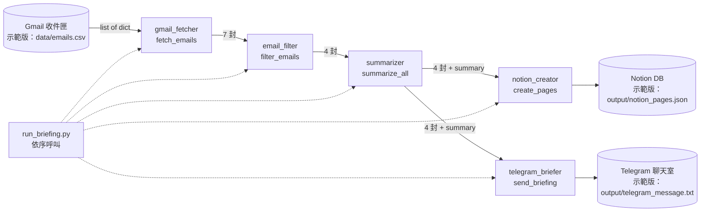

# 練習 01 解答 — 現有 Pipeline 分析

> 分析對象：題目指定的 `email-automation-演練/` 不在本 repo，因此依本章補充要求，在 `legacy/` 自建一支同名模組的示範 pipeline 當「現有系統」。
> 原版（擴充前）保存在 commit `79a35d9`，可用 `git show 79a35d9:legacy/<檔名>` 查看。
> 示範版用 CSV 代替 Gmail，Notion／Telegram 只寫本地檔案，不連任何真實帳號。

## 任務 1：資料流圖



純文字版：

```
run_briefing.main()
  └─ fetch_emails() ──► filter_emails() ──► summarize_all() ──┬─► create_pages()   → Notion
       7 封                4 封                4 封+摘要        └─► send_briefing()  → Telegram
```

| 段落 | 輸入 | 輸出 | 可能的失敗點 |
| ------ | ------ | ------ | ------------ |
| gmail_fetcher | Gmail MCP 設定（示範版：CSV 路徑） | 信件清單 `list[dict]`（id/sender/subject/body/received_at/has_attachment/labels） | Gmail auth 過期；網路逾時；API rate limit；原版 CSV 不存在或欄位缺漏時直接丟出 `FileNotFoundError`/`KeyError`，整條 pipeline 中斷 |
| email_filter | 信件清單 | 過濾後清單（移除 PROMOTIONS/SPAM/UPDATES 與 noreply） | 規則寫死在程式碼；`labels` 只比對整個字串，多標籤（`INBOX,UPDATES`）會漏判；原版用 `email["labels"]` 取值，欄位缺就 `KeyError`；誤殺重要的系統通知（例如付款失敗） |
| summarizer | 過濾後清單 | 每封加上 `summary` 欄位 | 真實版逐封呼叫 Claude API：逾時、429、費用失控、內文過長超出 token；示範版內文為空時摘要為空字串；HTML 信件未清洗 |
| notion_creator | 摘要清單 | Notion 頁面（示範版：JSON 檔路徑） | Notion token 失效；database schema 改名；重複執行會建重複頁面（沒有以 message id 去重）；原版寫檔失敗會讓 Telegram 也不送 |
| telegram_briefer | 摘要清單 | Telegram 訊息文字（示範版：寫檔） | Bot token 失效；訊息超過 4096 字上限；Markdown 特殊字元未跳脫導致 400；原版沒有 `mkdir`，輸出目錄不存在就失敗 |
| run_briefing | 無 | 印出簡報、統計 | 全部串行、沒有 try/except：任一步失敗整條斷掉且沒有通知；沒有紀錄已處理信件，重跑會重複發送 |

## 任務 2：改進機會

### 效能

1. **summarizer 改並行或批次**：原版逐封呼叫，N 封信就是 N 次往返。改用 `concurrent.futures.ThreadPoolExecutor`（限 3-5 並行，避開 rate limit），或把多封信合併成一次 Claude 請求。估計 20 封信可從約 20×2 秒降到約 8 秒。
2. **Notion 與 Telegram 並行**：兩者只依賴 summarizer 輸出，彼此獨立，可同時送出。
3. **增量抓信**：記住上次處理的 `received_at`／message id，只抓新信，避免每次重摘要。

### 可靠性

1. **每步驟錯誤處理與降級**：fetcher 失敗要明確報錯並 exit 1；Notion 失敗不該擋住 Telegram（**已在擴充版實作**：`run_briefing.run()` 對 `create_pages` 捕捉 `OSError` 後繼續）。
2. **輸入驗證**：fetcher 驗證必要欄位，缺欄位丟出自訂 `FetchError`（**已實作**，見 `gmail_fetcher.py`、測試 `test_csv_missing_columns_raises`）。
3. **冪等性**：以 message id 記錄已建立的 Notion 頁面，重跑不重複建頁、不重複推播。
4. **外部 API 重試**：對 429／5xx 做指數退避重試（最多 3 次）。

### 新功能（建議優先序）

1. **信件重要度評分 + 緊急通知**（最值得做，也是練習 02 的內容，**已實作**）：簡報依重要度排序，4-5 分另發緊急通知，解決「重要信淹沒在一般信件裡」的問題。
2. 每日回覆提醒：`requires_reply=True` 且超過 24 小時未回的信，隔天再提醒。
3. 週報彙整：從 Notion 匯總一週信件類別分布。

## 附：串接真實服務的範本（未執行，需要帳號／token）

以下只是範本，本練習**沒有**連線、沒有送出任何訊息。token 一律從環境變數讀取。

```python
# 範本：真實 Gmail（Gmail API，需 OAuth credentials.json，勿 commit）
from googleapiclient.discovery import build
def fetch_emails_gmail(creds, query="is:unread newer_than:1d"):
    service = build("gmail", "v1", credentials=creds)
    resp = service.users().messages().list(userId="me", q=query, maxResults=50).execute()
    return [service.users().messages().get(userId="me", id=m["id"], format="full").execute()
            for m in resp.get("messages", [])]

# 範本：Notion
import os, requests
def create_notion_page(summary):
    token = os.environ["NOTION_TOKEN"]; db_id = os.environ["NOTION_DB_ID"]
    requests.post("https://api.notion.com/v1/pages", timeout=30,
                  headers={"Authorization": f"Bearer {token}", "Notion-Version": "2022-06-28"},
                  json={"parent": {"database_id": db_id},
                        "properties": {"Name": {"title": [{"text": {"content": summary["subject"]}}]}}}
                  ).raise_for_status()

# 範本：Telegram
def send_telegram(text):
    token = os.environ["TELEGRAM_BOT_TOKEN"]; chat_id = os.environ["TELEGRAM_CHAT_ID"]
    requests.post(f"https://api.telegram.org/bot{token}/sendMessage", timeout=30,
                  json={"chat_id": chat_id, "text": text[:4096]}).raise_for_status()
```
