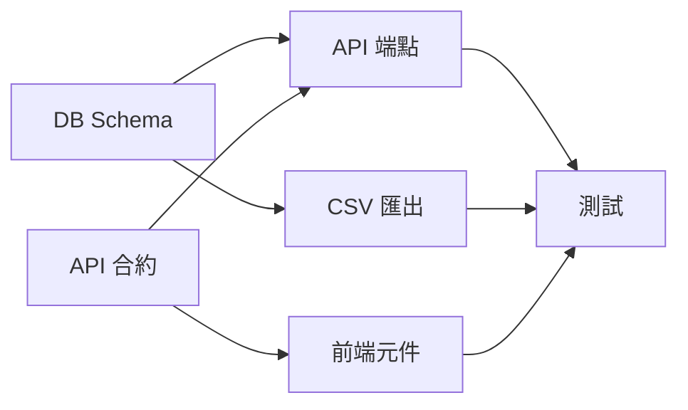

# 練習 02 解答 — Sub-agent 任務拆解（訂單報表）

> 已實際建檔並執行：
>
> - 5 個專案 subagent：`.claude/agents/report-*.md`
> - 訂單報表實作（Python 標準庫）：`order_report/`、`web/report.html`、`tests/test_order_report.py`
> - 12 個測試全部通過；`claude -p` 確認 5 個 agent 被讀到，並實際派遣 `report-test-writer` 跑測試

---

## 任務 1：單一 agent 做完整功能會遇到的問題

| 問題 | 具體表現（訂單報表為例） |
| --- | --- |
| **Context 膨脹** | SQL、API、前端、CSV、測試的程式碼與錯誤訊息全部累積在同一段對話；做到測試時前面的 schema 細節已被壓縮或遺忘 |
| **角色混淆** | 一下是 DBA 一下是前端，規則互相污染，例如在前端元件裡直接寫 SQL 思維、在 API 層做畫面格式化 |
| **任務互相干擾** | 修前端 bug 時順手改 API 回應格式，造成 CSV 匯出壞掉；改動範圍無法控制 |
| **無法並行** | 前端圖表和 CSV 匯出本來可以同時做，單一對話只能排隊 |
| **自我驗證偏差** | 同一個 context 寫程式又寫測試，容易寫出「配合實作」的測試（本次練習就遇到：測試預期值 5447 是手算錯的，正確為 5448，由測試失敗揪出） |
| **錯誤難定位** | 失敗時不知道是哪一層的問題，要回頭翻整段對話 |

---

## 任務 2：任務分解與依賴圖

### 子任務清單

| 代號 | 子任務 | subagent | 依賴 | 產出 |
| --- | --- | --- | --- | --- |
| A | 資料庫 Schema + 聚合查詢 | `report-db-schema` | 無 | `order_report/schema.sql`、`db.py` |
| B | API 端點 | `report-api-endpoint` | A | `order_report/api.py` |
| C | 前端圖表元件 | `report-frontend-chart` | **API 合約**（不需等 B 實作） | `web/report.html` |
| D | CSV 匯出 | `report-csv-export` | A | `order_report/export_csv.py` |
| E | 測試 | `report-test-writer` | A + B + D（C 的端對端檢查放最後） | `tests/test_order_report.py` |

### 依賴圖

```
            ┌─────────────────────────────┐
            │ 第 0 步：先定 API 合約（JSON 格式）│  ← 主 agent 負責
            └──────────────┬──────────────┘
                           │
[資料庫 Schema A] ─────────┼──────────────┐
        │                  │              │
        ├──→ [API 端點 B] ─┤    ┌─ 並行 ─┐ │
        │                  │    │         │ │
        └──→ [CSV 匯出 D] ─┼────┘         │ │
                           │              │ │
           [前端元件 C] ←───┘ (只靠合約，可與 A/B/D 同時開工)
                           │
        B + D + C 完成 ──→ [測試 E]（最後，串行）
```

文字版：

```
[資料庫 Schema] → [API 端點]、[CSV 匯出]（A 完成後，B 與 D 可並行）
[API 端點]     → [測試]
[前端元件]     → [測試]（只依賴 API 合約，從一開始就能與 A、B、D 並行）
[CSV 匯出]     → [測試]
[測試]         → 完成（等 B、C、D 都好）
```



**並行機會**：

1. 「A」與「C」可同時開工：前端只需要合約，可以先用假資料開發。
2. A 完成後，「B」與「D」可並行：兩者都只呼叫 `db.daily_summary()`，不改同一個檔案。
3. E 必須最後做，串行。

**關鍵設計**：先定「合約」才能並行。如果沒先定 API 回應格式，C 就必須等 B 做完，並行機會會消失。

---

## 任務 3：「API 端點」子任務的 Sub-agent Prompt

實際檔案：`.claude/agents/report-api-endpoint.md`。下面是完整派工用的規格書版本：

```markdown
# 子任務 B：訂單報表 API 端點

## 角色
你是後端 API 子任務負責人，只負責 HTTP 端點這一層。

## 相依性（前置條件，開工前先確認）
- [ ] `order_report/db.py` 已存在，提供
      `daily_summary(conn, date_from: str, date_to: str, status: str | None) -> list[dict]`
      每筆為 {"day": "YYYY-MM-DD", "orders": int, "revenue": float}
- [ ] `db.VALID_STATUS` 常數存在
- [ ] 遵守 docs/api-conventions.md
任一項不成立 → 停止並回報「前置條件不足：<哪一項>」，不要自己補做 A 的工作。

## 輸入（端點接收什麼）
GET /api/reports/orders?from=YYYY-MM-DD&to=YYYY-MM-DD[&status=paid|refunded|pending]
- from、to 必填，ISO 日期，含頭含尾
- from ≤ to，區間 ≤ 366 天
- status 選填

## 輸出（產出什麼，格式）
1. 檔案：`order_report/api.py`
   - `parse_params(query) -> (from, to, status)`，不合法丟 `ApiError(status, code, message)`
   - `build_report(conn, query) -> dict`
   - `make_handler(conn)`：回傳 http.server handler
2. 成功 200：
   {"data": {"from": "...", "to": "...", "status": null,
             "rows": [{"day": "2026-10-01", "orders": 3, "revenue": 1900.0}],
             "total": {"orders": 6, "revenue": 5448.0}}}
3. 錯誤：{"error": {"code": "<CODE>", "message": "<繁中說明>"}}
   | 狀態 | code |
   | 400 | MISSING_PARAM / INVALID_DATE / INVALID_RANGE / RANGE_TOO_LARGE / INVALID_STATUS |
   | 404 | NOT_FOUND |
   | 500 | INTERNAL（不可洩漏堆疊或 SQL） |
4. 完工回報（給主 agent）：檔案路徑、函式簽名、錯誤碼表、手動 smoke test 指令。

## 不做什麼（邊界）
- 不修改 schema.sql / db.py（發現問題就回報給 A）
- 不寫前端、不寫 CSV 格式邏輯（只呼叫 export_csv.rows_to_csv）
- 不做認證（由 API gateway 處理）
- 不寫完整測試套件（由子任務 E 負責；可附 1 個 smoke test 指令）
- 不新增第三方套件（只用 Python 標準庫）
```

### 實際執行結果

| 驗證 | 結果 |
| --- | --- |
| `python -m unittest discover -s tests -v` | **12 tests OK**（加 `-W error -X dev`，警告視為錯誤也通過） |
| 啟動 `python -m order_report.api 8799` 後用 curl 打 | JSON 200 ✅、`from > to` 回 400 `INVALID_RANGE` ✅、CSV 有 BOM + 中文表頭 ✅ |
| `claude -p` 詢問 report- 開頭的 subagent | 列出 5 個，依賴關係描述正確（`answer/claude-p-verify.txt`） |
| `claude -p` 派遣 `report-test-writer` | agent 實際執行並回報「12 個測試全部通過」，還額外抓到 ResourceWarning（`answer/claude-p-agent-run.txt`），已修正 |
